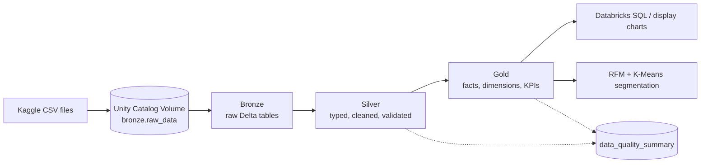
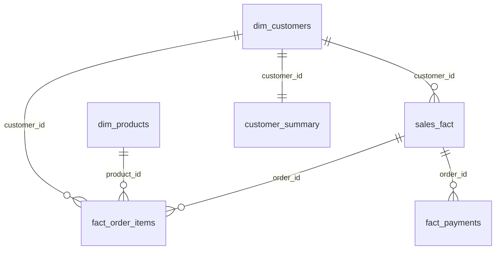
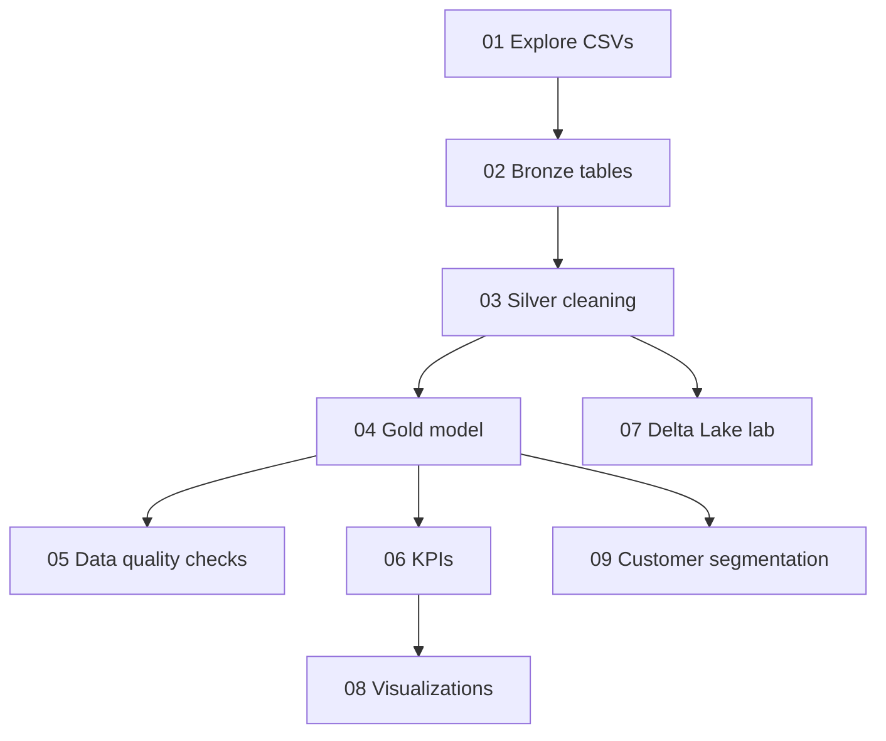

# Olist E-Commerce Data Lakehouse (Databricks, PySpark, Delta Lake, Unity Catalog)

A student end-to-end Data Engineering project. Raw e-commerce CSV files are loaded into a **Medallion
(Bronze → Silver → Gold) lakehouse** on Databricks, cleaned and validated with PySpark, modelled into
analytics-ready Delta tables, and used for 15 business KPIs, data-quality reporting, Delta Lake feature demos
and an RFM customer-segmentation (K-Means) extension.

> **Status note (please read):** the code in this repository was written and syntax-checked, but it has to be
> *run in Databricks* to produce results. The **Results** section below is a template to fill in with your own
> numbers after running the notebooks. No result in this repository is pre-filled or invented.

---

## 1. Problem Statement
Raw marketplace data is split into several files (customers, orders, items, payments, products). One order can have
**many items** and **many payments**, so naïvely joining the files inflates revenue. The business needs reliable
answers: *How much did we sell? Which categories, states and customers matter? How fast do we deliver?*

## 2. Objectives
- Ingest raw CSV files into Delta tables (Bronze) without losing information.
- Clean, type and validate the data (Silver) with sensible rules - no blind `dropna()`.
- Build a dimensional model (Gold) with a clearly defined **grain** and no double-counting.
- Compute 15 KPIs in PySpark and in SQL.
- Demonstrate Delta Lake features safely (ACID, MERGE, time travel, RESTORE ...).
- Report data quality and explain how it affects analytics.

## 3. Dataset
**Olist Brazilian E-Commerce** (Kaggle variant): <https://www.kaggle.com/datasets/bytadit/ecommerce-order-dataset>

| File | Key columns |
|---|---|
| `customers.csv` | customer_id, customer_zip_code_prefix, customer_city, customer_state |
| `orders.csv` | order_id, customer_id, order_status, order_purchase_timestamp, order_approved_at, order_delivered_timestamp, order_estimated_delivery_date |
| `products.csv` | product_id, product_category_name, product_weight_g, product_length_cm, product_height_cm, product_width_cm |
| `order_items.csv` | order_id, product_id, seller_id, price, shipping_charges |
| `payments.csv` | order_id, payment_sequential, payment_type, payment_installments, payment_value |

The CSV files are **not** stored in this repo (download them from Kaggle and respect its licence terms).

## 4. Technologies
Python · PySpark / Apache Spark · Databricks · Delta Lake · Unity Catalog (Volumes) · Databricks SQL · Spark MLlib (K-Means) · pytest · Git/GitHub

## 5. Architecture



### Medallion architecture
| Layer | Schema | What happens | Rule of thumb |
|---|---|---|---|
| Bronze | `ecommerce_catalog.bronze` | Exact copy of the CSVs as Delta (all columns as strings + `_ingested_at`, `_source_file`) | Never lose raw data |
| Silver | `ecommerce_catalog.silver` | Cast types, trim/normalise text, remove duplicate keys, separate invalid rows | Trustworthy, typed data |
| Gold | `ecommerce_catalog.gold` | Facts, dimensions, KPI tables at a defined grain | Ready for analysts |

### Gold data model



| Table | Grain (1 row = ...) |
|---|---|
| `sales_fact` | one order |
| `fact_order_items` | one order item |
| `fact_payments` | one payment |
| `dim_customers`, `dim_products` | one customer / one product |
| `customer_summary` | one customer |

**Why the separate grains?** Joining `orders → items → payments` directly turns 3 items × 2 payments into 6 rows
and counts every payment 3 times. This project aggregates items and payments to one row per order *before* joining,
and notebook 04 proves it by comparing totals (and demonstrating the inflation of a naïve join).

## 6. Pipeline Workflow



| Notebook | Purpose |
|---|---|
| `01_data_ingestion.py` | Read CSVs, check headers, schemas, counts, grain |
| `02_bronze_layer.py` | Write Bronze Delta tables + row-count validation |
| `03_silver_layer.py` | Null analysis, cleaning, invalid-row report, Silver tables |
| `04_gold_layer.py` | Build Gold tables, prove no revenue inflation |
| `05_data_quality_checks.py` | PASS/FAIL checks → `gold.data_quality_summary` |
| `06_kpi_analysis.py` | 15 KPIs → `gold.kpi_*` tables |
| `07_delta_lake_features.py` | ACID, schema enforcement/evolution, MERGE, time travel, UPDATE, DELETE, OPTIMIZE, VACUUM (dry run), RESTORE - on a **copy** table |
| `08_data_visualization.py` | Charts from the KPI tables with `display()` |
| `09_customer_segmentation.py` | RFM + K-Means (extension of the original notebook) |

## 7. Key Design Decisions
- **Explicit all-string schemas in Bronze** so a bad value can never silently turn into NULL at read time.
- **`try_cast` in Silver** (invalid values → NULL, then reported) instead of failing the job.
- **NULL delivery dates are kept** - they are normal for undelivered orders.
- **Order-item rows are not de-duplicated** - the dataset has no item id, so identical rows may be a real quantity > 1.
- **Revenue** = sum of `payment_value` for orders **not** `canceled`/`unavailable` that have payments (configurable in `src/config.py`).
- **Category revenue** uses item `price` (payments cannot be split per category).

## 8. KPI Definitions
| # | KPI | Table / grain | Definition |
|---|---|---|---|
| 1 | Total revenue | sales_fact (order) | Σ `total_payment_value` of revenue orders |
| 2 | Total orders | sales_fact | distinct revenue orders |
| 3 | Total customers | sales_fact | distinct customers with a revenue order |
| 4 | Average order value | sales_fact | revenue ÷ revenue orders |
| 5 | Top 10 customers | sales_fact | Σ spending per customer |
| 6 | Category revenue | fact_order_items (item) | Σ `price` per category |
| 7 | Monthly revenue | sales_fact | revenue by `purchase_year_month` |
| 8 | State revenue | sales_fact | revenue by `customer_state` |
| 9 | Payment methods | fact_payments (payment) | Σ `payment_value` by `payment_type` |
| 10 | Top categories | fact_order_items | by items sold |
| 11 | Order status distribution | sales_fact | all orders by status |
| 12 | Avg delivery time | sales_fact | avg days purchase→delivery (delivered orders only) |
| 13 | Late deliveries | sales_fact | delivered after estimated date (%) |
| 14 | Top selling products | fact_order_items | units sold per product |
| 15 | Purchase frequency | customer_summary | customers per order-count |

PySpark: `src/analytics/kpis.py` · SQL: `sql/kpi_analysis.sql`

## 9. Delta Lake Features (notebook 07)
All run on a throw-away copy table, `silver.delta_lab_orders`, which is dropped at the end.
`VACUUM` is **dry-run only** because it permanently deletes history.
See [`docs/delta_lake_features.md`](docs/delta_lake_features.md).

## 10. Data Quality
Checks include row counts between layers, primary-key uniqueness, NULL keys, invalid price/payment values,
date consistency, foreign keys (orphans) and Gold inflation checks.
Results are saved to `ecommerce_catalog.gold.data_quality_summary`. See [`docs/data_quality.md`](docs/data_quality.md).

## 11. Visualizations
Notebook 08 builds: monthly revenue (line), category revenue (bar), top 10 customers (bar), state revenue (bar),
payment methods (pie), order status (bar), late deliveries by state (bar) - all from real KPI tables.
*(Add screenshots to `docs/images/` after running and link them here.)*

## 12. Repository Structure
```
olist-ecommerce-data-lakehouse/
├── README.md
├── notebooks/            # Databricks notebooks (.py source format) + original .ipynb
├── src/
│   ├── config.py         # catalog / schema / path names, business constants
│   ├── ingestion/        # explicit schemas, CSV reader, Bronze writer
│   ├── transformations/  # silver.py (cleaning), gold.py (model)
│   ├── quality/          # reusable data quality checks
│   └── analytics/        # KPI functions
├── sql/                  # bronze/silver/gold checks + KPI analysis queries
├── tests/                # pytest (local Spark)
├── docs/                 # architecture, dictionary, workflow, quality, Delta, interview prep
├── requirements.txt
├── .gitignore
└── LICENSE
```
The original `notebooks/olist_customer_segmentation.ipynb` is kept unchanged.

## 13. Setup and Execution

### Databricks configuration
1. Unity Catalog structure (already existing - do not rename):
   ```
   ecommerce_catalog
   ├── bronze  └── raw_data (Volume)
   ├── silver
   └── gold
   ```
   If needed:
   ```sql
   CREATE CATALOG IF NOT EXISTS ecommerce_catalog;
   CREATE SCHEMA  IF NOT EXISTS ecommerce_catalog.bronze;
   CREATE SCHEMA  IF NOT EXISTS ecommerce_catalog.silver;
   CREATE SCHEMA  IF NOT EXISTS ecommerce_catalog.gold;
   CREATE VOLUME  IF NOT EXISTS ecommerce_catalog.bronze.raw_data;
   ```
2. Download the 5 CSV files from Kaggle and upload them to `/Volumes/ecommerce_catalog/bronze/raw_data/` as
   `customers.csv, orders.csv, products.csv, order_items.csv, payments.csv`.
3. Add this repo to Databricks: **Workspace → Create → Git folder** → paste the GitHub URL.
4. Attach a cluster (or serverless compute) that can read Unity Catalog Volumes.

### Run order
Open `notebooks/` and run **01 → 02 → 03 → 04**, then **05, 06, 07, 08, 09** (any order after 04; 08 needs 06).
Each notebook adds the repo root to `sys.path` so `from src... import ...` works inside a Git folder.

### Run tests (optional, local)
```bash
pip install -r requirements.txt     # needs Java 8/11/17 for PySpark
pytest -q
```

### If your CSV headers differ
Edit the column lists in `src/ingestion/schemas.py` (single place). Notebook 01 checks headers against the schema.

## 14. Results (fill in after running)
| Metric | Your value |
|---|---|
| Rows per Bronze table | |
| Rows removed in Silver (invalid / duplicates) | |
| Total revenue | |
| Total orders / customers | |
| Average order value | |
| Average delivery days / late-delivery % | |
| Data-quality checks passed / failed | |

## 15. Challenges
- **Multiple items and payments per order** → aggregate to order level before joining; validated with total comparisons.
- **No item id in `order_items`** → cannot safely de-duplicate; treated identical rows as possible quantities.
- **Undelivered orders have NULL dates** → delivery KPIs use delivered orders only.
- **Products without a category** → labelled `unknown` rather than dropped.
- **`customer_id` may be per-order** → purchase-frequency and RFM results must be interpreted carefully (see `docs/data_dictionary.md`).

## 16. Future Enhancements (not implemented)
- Databricks Workflows / Jobs to schedule the notebooks.
- Incremental loads with Auto Loader and `MERGE` into Silver.
- Writing rejected rows to quarantine tables.
- Databricks SQL dashboard built from `sql/kpi_analysis.sql`.
- Great Expectations / DLT expectations; CI to run tests.
- Seller and review analysis (not in the current five files).

## License
MIT - see [LICENSE](LICENSE).
